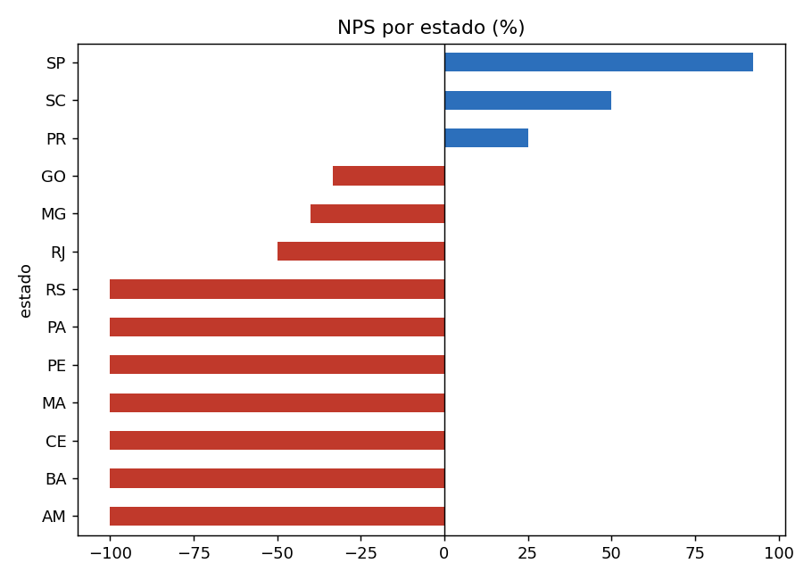
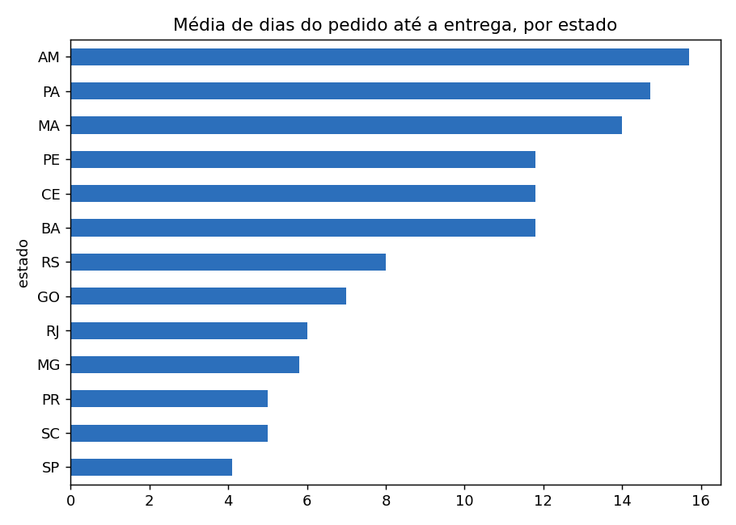
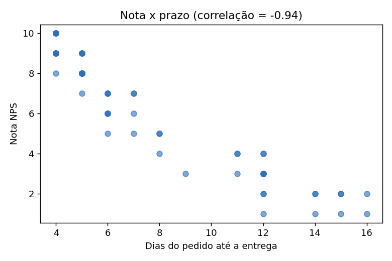

# Hermex Log — Projeto NPS: Automação, Dados e IA

Projeto de transformação digital para a Hermex Log (logística): padronizar a comunicação de prazos, mapear e automatizar o pós-vendas, classificar feedbacks de NPS com IA e acompanhar tudo em dashboard e base de conhecimento.

> ⚠️ **Status honesto do repositório:** a parte de **dados, análise, planejamento, documentação e arquivos importáveis** está pronta. Os artefatos que vivem em ferramentas externas (GPT no ChatGPT, board no Miro, workflow no n8n, dashboard no Looker Studio, Notion, Forms) precisam ser **criados/importados por você** com os guias deste repositório, e os screenshots devem ser adicionados depois. Nada foi testado nessas ferramentas.

## 1. Cenário de negócio
Vendas e pós-vendas se comunicam mal, reclamações não têm tratamento estruturado, não há coleta e classificação automática de feedback e o atendimento repete respostas sobre processos que já existem em documentos.

## 2. Perguntas respondidas
| Etapa | Pergunta-chave | Onde está a resposta |
|---|---|---|
| 1 | Como estruturar um GPT reutilizável que padronize prazos, com certezas, suposições e dúvidas mapeadas? | `docs/01_planejamento_gpt.md`, `docs/briefing_gpt_hermex_prazos.txt` |
| 2 | Quais são os pontos críticos de comunicação e como a RACI viabiliza a automação? | `docs/02_processo_posvendas.md`, `miro/`, `data/handoff_vendas_posvenda.xlsx` |
| 3 | Como integrar coleta, regra de negócio e IA com validação humana? | `docs/03_n8n_workflow.md`, `n8n/hermex_nps_automacao.json` |
| 4 | Como combinar dashboard e documentação semântica para decisão e para agentes de IA? | `docs/04_looker_studio.md`, `notion/`, `docs/05_governanca_de_dados.md` |

## 3. Ferramentas
Google Sheets/Forms/Gmail, ChatGPT (GPTs), Miro, n8n, Gemini API, Looker Studio, Notion, Python (pandas, matplotlib) para validar os números.

## 4. Estrutura do repositório
```
data/        CSVs, planilha .xlsx (handoff + Matriz RACI), classificação de referência dos detratores
docs/        planejamento, processo, n8n, Looker, governança, análise de dados
miro/        fluxograma em Mermaid
n8n/         workflow importável (JSON)
notion/      3 páginas da base de conhecimento
scripts/     analise.py (reproduz todos os números)
screenshots/ gráficos de análise (+ coloque aqui os prints das ferramentas)
```
Para reproduzir a análise: `pip install pandas matplotlib tabulate` e `python scripts/analise.py`.

## 5. Principais resultados (60 pedidos, abril/2025)
| Indicador | Valor |
|---|---|
| NPS geral | **-26,7%** (15 promotores, 14 neutros, 31 detratores) |
| Média pedido → envio / → entrega | 3,0 / 8,0 dias |
| NPS Sudeste / Sul / Centro-Oeste | +29,2% / -8,3% / -33,3% |
| NPS Nordeste / Norte | **-100% / -100%** (21 respostas, nenhum promotor) |
| Correlação nota × dias até a entrega | **-0,94** |
| NPS com entrega em até 5 dias | +62,5% (acima de 8 dias: -100%) |
| Pedidos dentro do SLA (contado do pedido) | 77% (46/60); contado só no transporte: 100% |
| Causa dos 31 detratores (classificação manual) | Atraso 18, Defeito 5, Atendimento 3, Embalagem 2, Outro 3 |





## 6. Insights e recomendações
1. **Prazo é o principal motor do NPS.** O atraso responde por 18 dos 31 detratores e a correlação é -0,94. Agir em prazo e comunicação rende mais que qualquer outra ação.
2. **O SLA atual é cumprido no transporte, mas o cliente conta do pedido.** O transporte ficou dentro da faixa em 100% dos casos, enquanto 23% dos pedidos passaram do prazo contado do pedido. O tempo de separação e postagem (3 dias em média, 4–5 no Norte/Nordeste) é a parte que a empresa controla. *Recomendação:* meta de postagem em até 1–2 dias e SLA contado a partir do pedido.
3. **Norte e Nordeste: o problema é a faixa prometida, não só atraso.** 100% dos pedidos do Norte e 87% do Nordeste estavam dentro do SLA, mas todos os clientes foram detratores. *Recomendação:* revisar a promessa (transportadora regional, centros de distribuição) e alinhar a expectativa na venda, com o GPT "Hermex Prazos".
4. **Comunicação de rastreio** aparece em vários comentários (P014, P026, P041, P052). *Recomendação:* automatizar atualização de rastreio ao cliente no n8n.
5. **Defeito/avaria e extravio (8 casos)** pedem logística reversa e reembolso rápidos; a base do Notion padroniza o atendimento.
6. **Padronizar o detrator em `nota < 7`** em n8n e dashboard, para não deixar as notas 6 sem tratamento (4 pedidos).
7. **Completar o handoff:** hoje cobre 30 dos 60 pedidos. Detratores nos 30 pedidos com handoff somam R$ 4.795,50 (43% do valor de R$ 11.035,50).

## 7. Desafios e como foram tratados
| Desafio | Tratamento |
|---|---|
| Duas tabelas de prazo no enunciado | Adotada uma só (Etapa 4) em GPT, Notion e dashboard |
| Limiar de detrator `<6` (n8n) × `<7` (dashboard) | Padronizado em `<7`; fácil de trocar no nó IF |
| Forms não traz nome nem e-mail | Nó de busca em `pesquisa_satisfacao` pelo `id_pedido` |
| Handoff só com P001–P030 | Gatilho usa a planilha de pesquisa; recomendações no doc da Etapa 2 |
| Gemini pode responder além de uma palavra | Prompt restritivo, temperatura 0 e nó que valida a categoria |
| Prazo em "dias úteis" × dados em dias corridos | Marcado como suposição a validar |

## 8. Passo a passo para finalizar
1. Crie a pasta no Drive, suba os CSVs (ou o `.xlsx`) e o Forms, conforme `docs/03`.
2. Crie o GPT com `docs/briefing_gpt_hermex_prazos.txt` e registre os testes em `docs/01`.
3. Monte o fluxo no Miro (`miro/fluxograma_posvendas.mmd`).
4. Importe `n8n/hermex_nps_automacao.json`, ligue as credenciais e teste.
5. Monte o dashboard (`docs/04`) e cole as 3 páginas de `notion/` no Notion.
6. Adicione os prints em `screenshots/` e linke aqui.
