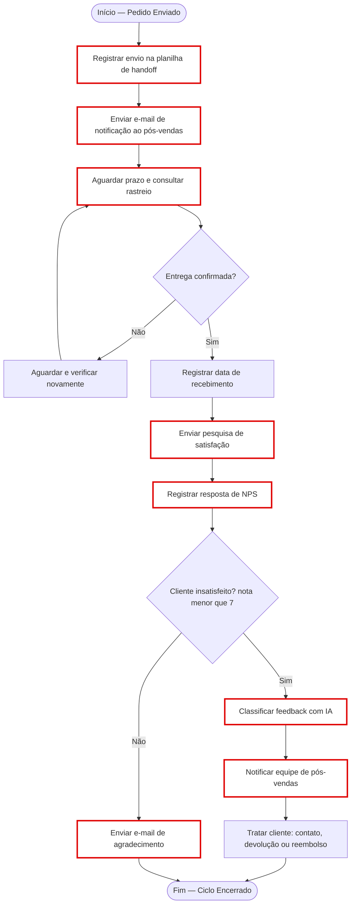

# Etapa 2 — Mapeamento do processo de pós-vendas

## 1. Fluxograma (Miro)
O arquivo `miro/fluxograma_posvendas.mmd` contém o fluxo em Mermaid. No Miro: **Apps → Mermaid → colar o código**, ou redesenhe manualmente com a simbologia abaixo. Para finalizar, confira que a borda vermelha esteja nas atividades marcadas e adicione as anotações de critério ao lado.

**Simbologia:** ovais = Início/Fim; retângulos arredondados = atividades; losangos = decisões. **Looping:** "Entrega confirmada? → Não → Aguardar e verificar novamente → volta a consultar o rastreio". Sugestão: limitar o loop (ex.: após 3 verificações sem confirmação, escalar ao pós-vendas).

Atividade `Registrar data de recebimento` e `Tratar cliente` não são candidatas: a primeira depende de um dado externo ainda não padronizado, e a segunda exige julgamento humano (validação humana é requisito do projeto).

## 2. Atividades candidatas à automação (borda vermelha)
Critérios: **R**epetitividade, **Re**gras claras, **T**ransferência de informação entre equipes, **C**riticidade, **Ra**streabilidade.

| Atividade | Critérios que justificam | Observação |
|---|---|---|
| Registrar envio na planilha de handoff | Transferência de informação entre equipes; Rastreabilidade; Repetitividade | Hoje a planilha cobre 30 dos 60 pedidos pesquisados (50%) |
| Enviar e-mail de notificação ao pós-vendas | Transferência entre equipes; Regras claras; Repetitividade | Gatilho: nova linha na planilha |
| Aguardar prazo e consultar rastreio | Repetitividade; Regras claras | Loop com limite de tentativas |
| Enviar pesquisa de satisfação | Repetitividade; Regras claras | Disparo após confirmação de entrega |
| Registrar resposta de NPS | Rastreabilidade; Repetitividade | Forms → Sheets já é automático |
| Classificar feedback com IA | Repetitividade; Regras claras (5 categorias); Criticidade (detrator) | Com validação humana |
| Notificar equipe de pós-vendas | Transferência entre equipes; Criticidade; Rastreabilidade | E-mail com cliente, nota, categoria e comentário |
| Enviar e-mail de agradecimento | Repetitividade; Regras claras | Caminho de nota ≥ 7 |

## 3. Matriz RACI
Aba **"Matriz RACI"** do arquivo `data/handoff_vendas_posvenda.xlsx` (também em `data/matriz_raci.csv`). Cada linha tem exatamente um **A**.

| Atividade | Vendas | Pós-Vendas | N8N | Correios | Liderança |
|---|---|---|---|---|---|
| 1. Registrar envio na planilha de handoff | A/R | I | I | - | I |
| 2. Enviar e-mail de notificação ao pós-vendas | C | A | R | - | I |
| 3. Transportar e entregar o pedido | I | A | I | R | I |
| 4. Confirmar entrega | I | A | R | C | I |
| 5. Enviar pesquisa de satisfação | I | A | R | - | I |
| 6. Registrar respostas de NPS | I | A | R | - | I |
| 7. Classificar feedback do detrator com IA | I | A | R | - | I |
| 8. Notificar equipe de pós-vendas | I | A | R | - | I |
| 9. Tratar cliente insatisfeito | C | A/R | - | C | I |
| 10. Analisar NPS/SLA e definir melhorias | C | R | I | C | A |

*Escolhas:* o Pós-Vendas é **A** das atividades automatizadas, porque responde pelo resultado mesmo quando o N8N executa; a Liderança é **A** apenas da análise e decisão de melhoria.

## 4. Planilha de handoff como gatilho do n8n
Verificação feita nos 30 registros de `handoff_vendas_posvenda.csv`:
- Cada linha = um pedido (`id_pedido` único, P001–P030). ✔
- Campos essenciais (`id_pedido`, `cliente`, `email_cliente`) preenchidos nas 30 linhas. ✔ 
- Todos têm `status_pagamento` = Aprovado e `responsavel_posvenda` (Maria 15 / João 15). ✔
- **Lacunas encontradas:** (a) faltam os pedidos P031–P060, que existem na pesquisa de satisfação; (b) a coluna `observacoes` mistura "Sem observações" (11 linhas) com texto livre. Sugestões: usar célula vazia no lugar de "Sem observações"; incluir colunas `data_envio`, `data_recebimento` e `prazo_estimado` para o gatilho do n8n poder confirmar a entrega; usar um status do processo (ex.: Enviado, Entregue, Pesquisa enviada).
- Para o gatilho do workflow de NPS usamos a planilha `pesquisa_satisfacao`, que tem os 60 pedidos com nome e e-mail.

## 5. Justificativa (Bloco de notas)
O ponto de comunicação entre vendas e pós-vendas, a planilha de handoff, é o mais crítico para automação porque atende ao menos quatro dos cinco critérios. Primeiro, a **transferência de informações entre equipes**: é nela que dados do pedido (cliente, e-mail, telefone, responsável e observações) passam de Vendas para Pós-Vendas, e qualquer falha aqui interrompe o restante do ciclo. Segundo, a **repetitividade**: o registro e o aviso se repetem a cada pedido enviado e hoje dependem de preenchimento manual. Isso explica o resultado observado, em que só 30 dos 60 pedidos pesquisados têm linha de handoff. Terceiro, as **regras claras**: quando há uma nova linha com status de pagamento aprovado, o pós-vendas responsável deve ser avisado. Esse caminho é determinístico e fácil de implementar no n8n. Quarto, a **rastreabilidade**: uma planilha única e padronizada registra quem recebeu qual pedido e quando, algo impossível com avisos por conversa avulsa. Por fim, a **criticidade**: 31 dos 60 clientes pesquisados (52%) foram detratores, e sem handoff confiável a equipe não consegue agir sobre eles com rapidez.
