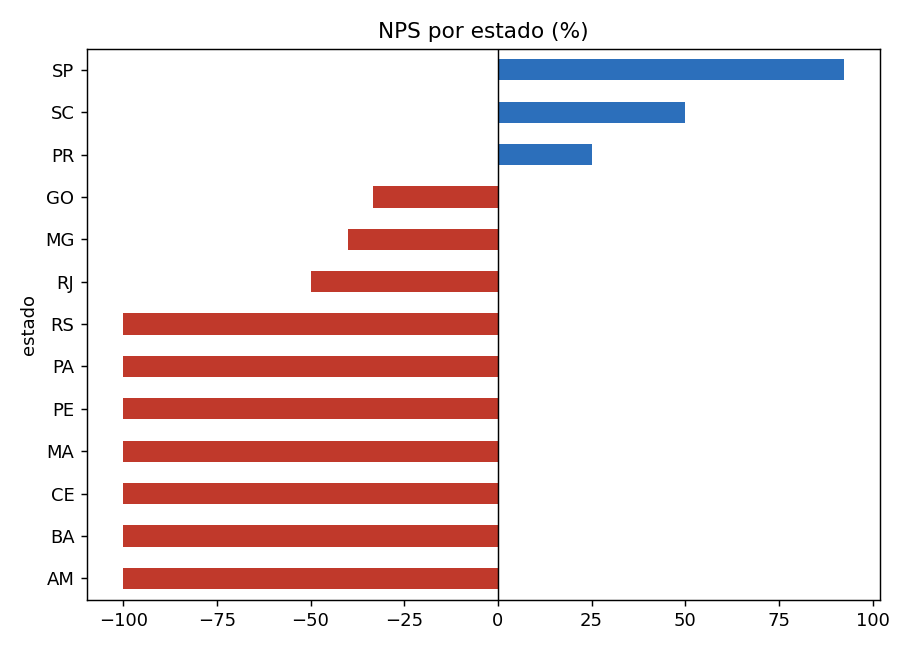
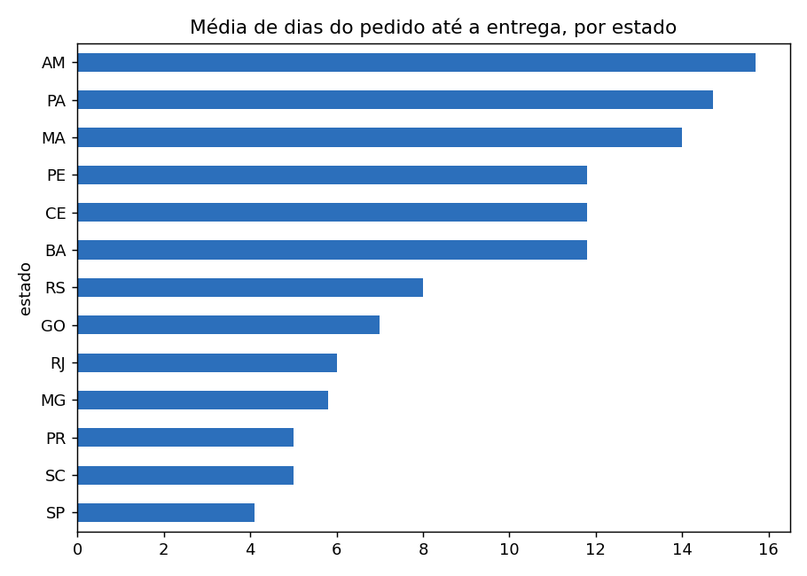
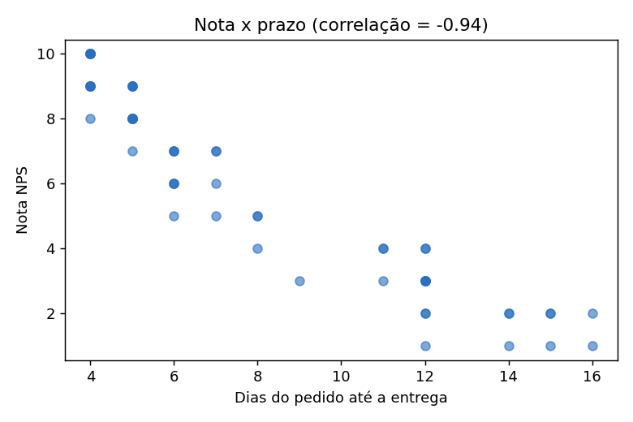

# Análise dos dados — NPS e SLA da Hermex Log

> Gerado por `scripts/analise.py` a partir de `data/pesquisa_satisfacao.csv` (60 respostas, P001–P060, abril/2025).
> Definições: Promotor = nota ≥ 9; Detrator = nota ≤ 6; NPS = %promotores − %detratores.
> Use estes números para **validar** os campos calculados do Looker Studio.

## Indicadores gerais
- Respostas: **60** | Promotores: **15** | Detratores: **31** | Neutros: **14**
- **NPS geral: -26.7%** (nota média 5.83)
- Média de dias até o envio: **3.0** | até a entrega: **8.0** | só transporte: **5.1**
- Correlação entre nota e dias até a entrega: **-0.94** (quanto maior o prazo, menor a nota)
- Se o detrator fosse `nota < 6` (como no enunciado da etapa 3), seriam 27 detratores e NPS de -20.0%. As 4 notas 6 (P014, P026, P031, P047) ficariam sem tratamento.

## Por região
| regiao       |   Respostas |   Promotores |   Detratores |   NPS (%) |   Nota média |   Dias até envio |   Dias até entrega |   Dias transporte |   % dentro SLA (pedido→entrega) |
|:-------------|------------:|-------------:|-------------:|----------:|-------------:|-----------------:|-------------------:|------------------:|--------------------------------:|
| Nordeste     |          15 |            0 |           15 |    -100   |         2.8  |              4.1 |               12.1 |               7.9 |                            86.7 |
| Norte        |           6 |            0 |            6 |    -100   |         1.67 |              5.2 |               15.2 |              10   |                           100   |
| Centro-Oeste |           3 |            0 |            1 |     -33.3 |         6.67 |              3   |                7   |               4   |                           100   |
| Sul          |          12 |            3 |            4 |      -8.3 |         7.08 |              2.3 |                6   |               3.7 |                            66.7 |
| Sudeste      |          24 |           12 |            5 |      29.2 |         8.04 |              2   |                4.9 |               2.9 |                            66.7 |

## Por estado
| estado   |   Respostas |   Promotores |   Detratores |   NPS (%) |   Nota média |   Dias até envio |   Dias até entrega |   Dias transporte |   % dentro SLA (pedido→entrega) |
|:---------|------------:|-------------:|-------------:|----------:|-------------:|-----------------:|-------------------:|------------------:|--------------------------------:|
| AM       |           3 |            0 |            3 |    -100   |         1.67 |              5.3 |               15.7 |              10.3 |                           100   |
| BA       |           5 |            0 |            5 |    -100   |         3.2  |              4   |               11.8 |               7.8 |                           100   |
| CE       |           4 |            0 |            4 |    -100   |         3.25 |              4   |               11.8 |               7.8 |                           100   |
| MA       |           2 |            0 |            2 |    -100   |         1.5  |              5   |               14   |               9   |                             0   |
| PE       |           4 |            0 |            4 |    -100   |         2.5  |              4   |               11.8 |               7.8 |                           100   |
| PA       |           3 |            0 |            3 |    -100   |         1.67 |              5   |               14.7 |               9.7 |                           100   |
| RS       |           4 |            0 |            4 |    -100   |         4.5  |              3   |                8   |               5   |                             0   |
| RJ       |           6 |            0 |            3 |     -50   |         6.33 |              2.2 |                6   |               3.8 |                            33.3 |
| MG       |           5 |            0 |            2 |     -40   |         6.6  |              2   |                5.8 |               3.8 |                            20   |
| GO       |           3 |            0 |            1 |     -33.3 |         6.67 |              3   |                7   |               4   |                           100   |
| PR       |           4 |            1 |            0 |      25   |         8.25 |              2   |                5   |               3   |                           100   |
| SC       |           4 |            2 |            0 |      50   |         8.5  |              2   |                5   |               3   |                           100   |
| SP       |          13 |           12 |            0 |      92.3 |         9.38 |              2   |                4.1 |               2.1 |                           100   |

## NPS por faixa de prazo (pedido → entrega)
| faixa      |   Pedidos |   NPS (%) |   Nota média |
|:-----------|----------:|----------:|-------------:|
| até 5 dias |        24 |      62.5 |         8.83 |
| 6–8 dias   |        14 |     -64.3 |         5.93 |
| 9–11 dias  |         4 |    -100   |         3.5  |
| 12+ dias   |        18 |    -100   |         2.28 |

## Classificação dos 31 detratores (referência manual)
| categoria_referencia   |   count |
|:-----------------------|--------:|
| Atraso                 |      18 |
| Defeito                |       5 |
| Atendimento            |       3 |
| Outro                  |       3 |
| Embalagem              |       2 |

Vários comentários citam mais de um problema (ex.: P002 "caixa amassada e fora do prazo"); a categoria de referência é a predominante. Compare com a saída do Gemini no n8n.

## Handoff × detratores
Dos 30 pedidos com dados de handoff, os detratores representam **R$ 4,795.50** de **R$ 11,035.50** (43% do valor).

## Gráficos

